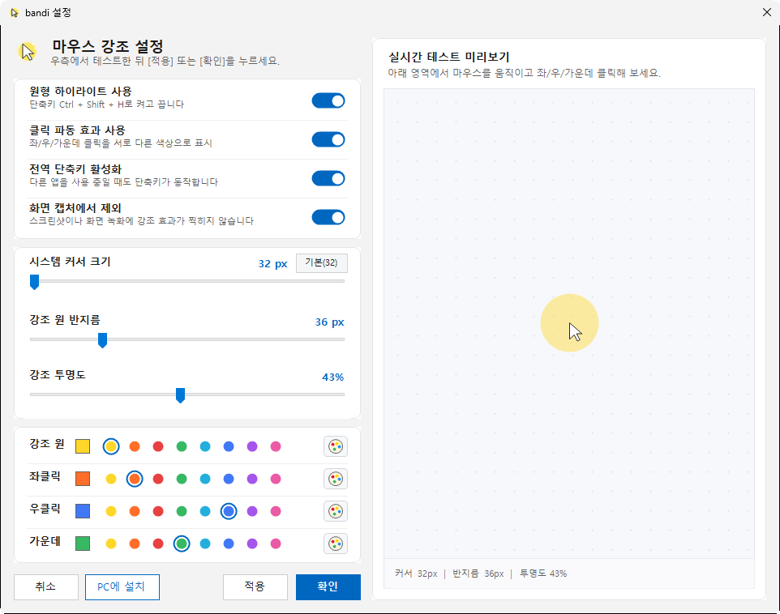

# bandi

마우스 커서 위치 식별용 Windows 트레이 프로그램. 발표·강의·화면 녹화 시 사용.


## 1. 기능

- **커서 강조**: 커서 주변 반투명 원 표시. 색상·반지름·투명도 조절 가능
- **클릭 표시**: 좌·우·가운데 클릭을 색상별 파동으로 표시
- **커서 크기**: 32~256px 조절. 실행 중에만 적용, 종료 시 원래 크기로 복원
- **캡처 제외**: 스크린샷·녹화 화면에서 강조 효과 제외 (Windows 10 2004 이상)
- **단축키**: `Ctrl + Shift + H`로 강조 효과 켜기/끄기
- **자동 실행**: 로그온 시 자동 시작
- **미리보기**: 설정 창에서 즉시 확인



## 2. 요구 사항

- Windows 10 (2004 이상) 또는 Windows 11, x64
- [.NET 10 Desktop Runtime](https://dotnet.microsoft.com/download/dotnet/10.0)
- 관리자 권한. 사유:
  - 관리자 권한으로 실행 중인 창 위에서도 마우스를 감지하기 위해
  - 자동 실행을 최고 권한으로 등록하기 위해
  - Program Files에 설치하기 위해

## 3. 다운로드

[Releases](../../releases)에서 최신 `bandi.exe` 다운로드. 설치 파일 없이 exe 단독 동작.

> **"Windows의 PC 보호" 경고 시**: **추가 정보 → 실행** 클릭.
> 코드 서명 인증서 부재로 인한 경고. 소스 전체 공개, 직접 빌드 가능.

## 4. 사용법

1. `bandi.exe`를 관리자 권한으로 실행
2. 첫 실행 시 실행 방식 선택: 현재 위치에서 바로 실행, 또는 `C:\Program Files\bandi`에 설치
3. 이후 트레이 아이콘으로 조작

| 입력 | 동작 |
|---|---|
| 트레이 아이콘 좌클릭 | 강조 효과 켜기/끄기 |
| 트레이 아이콘 가운데 클릭 | 설정 창 열기 |
| 트레이 아이콘 우클릭 | 메뉴 (설정, 자동 실행, 종료) |
| `Ctrl + Shift + H` | 강조 효과 켜기/끄기 |

설정 파일: `C:\Users\<사용자명>\AppData\Roaming\bandi\settings.json`

## 5. 빌드

필요: [.NET 10 SDK](https://dotnet.microsoft.com/download/dotnet/10.0)

```powershell
# 디버그 빌드
dotnet build

# 배포용 단일 실행 파일 (결과: publish\bandi.exe)
dotnet publish -p:PublishProfile=win-x64
```

- 릴리스 빌드: 디버그 정보 exe 내장, 빌드 PC 경로 미포함
- 새 버전 배포 시 `bandi.csproj`의 `Version` 값을 올릴 것

## 6. 제거

1. 트레이 메뉴에서 **윈도우 시작 시 자동 실행** 해제
2. **종료** 클릭. 커서 크기 자동 복원
3. 프로그램 폴더 삭제 (설치 시): `C:\Program Files\bandi`
4. 설정 폴더 삭제: `C:\Users\<사용자명>\AppData\Roaming\bandi`
   - 탐색기 주소창에 `%APPDATA%\bandi` 입력 시 즉시 이동

## 7. 라이선스

[MIT](LICENSE)
